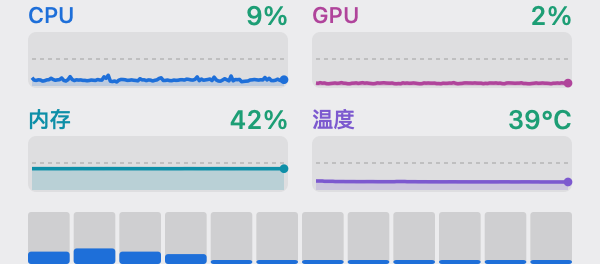

# CoreBar

**CPU, GPU, RAM and temperature in your menu bar — one status item, four trend charts, every core on the chip.**

A hand-written app — 809 lines of Swift plus a 515-line C sensor module — with **zero third-party dependencies, no subprocess, and no Python anywhere**. It costs **≈13 MiB and 0.26 % of a core** where keeping [macmon](https://github.com/vladkens/macmon) in a Terminal window costs **≈75 MiB**.

[中文说明 →](./README.zh-CN.md) · [Full feature list](docs/features.md) · [Changelog](CHANGELOG.md) · [**The talk →**](TALK.md)

> Formerly **MacMonBar**. Renamed in 0.4.0, after 0.3.0 removed the last thing that ever tied it to another project. Old links to the repository still redirect here.

     




---

## Performance at a glance

| | Terminal route | CoreBar | Difference |
|---|---|---|---|
| Memory (footprint) | ≈ 75 MiB | **≈ 13 MiB** | **−83 %** |
| CPU (2 s refresh) | ≈ 0.62 % of a core | **0.26 %** of a core | −58 % |
| Incremental power | — | **≈ 2.3 mW** | ≈ 0.07 % of a charge per day |
| GPU | — | **0.000 %** | pure AppKit 2D, rasterized on the CPU |

Measured, not estimated — `ri_phys_footprint` via `libproc`, CPU time over 15-second-plus windows, multiple rounds. Against the last two-process build (v0.2.9, app + `macmon pipe` child, measured head-to-head in the same session): **21.4 → 12.9 MiB (−40 %)** and **0.392 → 0.263 % of a core (−33 %)**, with readouts bit-identical to macmon. Full methodology, cost decomposition, refresh-interval table, the power calibration and the sample-by-sample parity table: **[docs/performance.md](docs/performance.md)** · **[docs/macmon.md](docs/macmon.md)**.

## Why CoreBar

- **Honest CPU numbers.** CPU and per-core utilization are sampled by the app itself through Mach `host_processor_info`, so all cores appear and the count comes from the kernel. macmon's own `cpu_usage_pct` is a frequency-weighted residency metric: under a 12-thread all-core load it reports **59.0 %** where the true utilization is **99.3 %**. **[How →](docs/how-it-works.md)**
- **One process, nothing to install.** GPU utilization and temperature come from a native C module (`src/sensors.c`) that talks to `libIOReport` and `AppleSMC`/`IOHID` directly — no child process, no `brew install`, no JSON parsing. **[How we dropped the subprocess →](docs/macmon.md)**
- **No Dock icon, no window, nothing to switch to.** `LSUIElement`, so it lives in the menu bar and nowhere else.
- **Zero dependencies.** AppKit + Foundation + Mach + one C translation unit. No SwiftPM, no Carthage, no vendored code, no Rust, no Python — the toolchain and the runtime are both Python-free.
- **Not a widget.** Menu bar is the only form that can sample at 2 Hz without keeping a terminal session alive, needs no host app and no App Group — WidgetKit is timeline-driven and throttled to minute granularity, so a widget ends up heavier than the thing it wraps.
- **Two disjoint colour systems.** Charts use identity hues (blue CPU, rose GPU, cyan memory, purple temperature); the numbers use value hues (green / amber / red by their own thresholds). A chart can never collide with a number wearing the same colour. **[Design notes →](docs/design.md)**

## Install

Requires macOS 13+ on Apple Silicon. **Nothing else** — there is no companion binary to install.

**Download** the latest release:

**[→ Download CoreBar (macOS, Apple Silicon)](https://github.com/HairuoLiu/CoreBar/releases/latest)**

Unzip, drag `CoreBar.app` to `/Applications`, and open it. There is no Dock icon — look at your menu bar.

**Or build it from source** (needs Xcode Command Line Tools):

```bash
git clone https://github.com/HairuoLiu/CoreBar.git
cd CoreBar
./build.sh          # compiles src/main.swift + src/sensors.c → ./CoreBar.app
open CoreBar.app
```

### Start at login

**System Settings → General → Login Items & Extensions → Open at Login → +** and pick `CoreBar.app`.

### Configure

Click the menu-bar item and pick from the menu: percentage colouring (**on**), gauges (off), temperature (off), per-core row (**on**), refresh interval (**2 s** default; 1 / 2 / 5 s available). Full menu reference: **[docs/features.md](docs/features.md)**.

<details>
<summary><b>For AI agents — installing this unattended</b></summary>

Resolve the machine first: Apple Silicon (`arm64`) or Intel (`x86_64`), and macOS 13+ (`sw_vers -productVersion`). CoreBar is distributed as a Universal Binary supporting both architectures.

```bash
#!/usr/bin/env bash
# CoreBar unattended install. Safe to re-run. No Python required.
set -euo pipefail

# 1. CoreBar — resolve the newest release asset instead of hard-coding a version
URL=$(curl -fsSL https://api.github.com/repos/HairuoLiu/CoreBar/releases/latest \
      | grep -o '"browser_download_url": *"[^"]*\.zip"' | head -n 1 \
      | sed 's/.*": *"//; s/"$//')
[ -n "$URL" ] || { echo "没找到 release 资源" >&2; exit 1; }
curl -fsSL "$URL" -o /tmp/CoreBar.zip
rm -rf /tmp/CoreBar-app && mkdir -p /tmp/CoreBar-app
unzip -oq /tmp/CoreBar.zip -d /tmp/CoreBar-app

# 2. install + clear the quarantine bit so it launches without a Gatekeeper prompt
rm -rf /Applications/CoreBar.app
mv /tmp/CoreBar-app/CoreBar.app /Applications/
xattr -dr com.apple.quarantine /Applications/CoreBar.app 2>/dev/null || true

# 3. launch, then confirm the process is alive — it is LSUIElement, so there is no window
open /Applications/CoreBar.app
sleep 2
pgrep -x CoreBar >/dev/null && echo "OK: CoreBar running" || { echo "启动失败" >&2; exit 1; }
```

Notes for an agent:

- Success is a single process named `CoreBar`. There is **no** child process — GPU and temperature are read in-process by the native C sensor module.
- The app does not read anything from disk at launch; no `PATH` lookups, no install step to verify.
- Do **not** try to screenshot the app to verify it. It has no window; use `pgrep` and the menu-bar item's presence.
- To uninstall: quit from the menu, delete `/Applications/CoreBar.app`. Nothing else is written outside the bundle.

</details>

## Troubleshooting

<details>
<summary><b>Something is wrong — open this</b></summary>

| Symptom | Cause | Fix |
|---|---|---|
| GPU / temperature show `—` | The native sensor module could not initialize (rare — a future macOS locking down the private APIs) | Nothing to install. CPU and memory keep working; report the macOS version if it persists. |
| Everything shows `—`, including CPU | Should be impossible — CPU has its own timer. Report it. | — |
| Values sit at `0 %` and never move | An old build (≤ 0.1.x) that depended on macmon for *all* metrics | Update to 0.2.0 or later |
| Menu bar item gone after a restart | Not registered as a login item | **System Settings → General → Login Items & Extensions → Open at Login → +** |
| Menu bar item hidden behind the notch | macOS drops items off the right edge when the bar is full | `⌘`-drag the item to reorder it, or quit other menu-bar apps |
| "CoreBar is damaged / cannot be opened" | Gatekeeper quarantine on a downloaded, unsigned build | `xattr -dr com.apple.quarantine /Applications/CoreBar.app` |
| `xcrun: error: invalid active developer path` when building | Command Line Tools not installed | `xcode-select --install` |
| `swiftc: error: unable to find utility` | Same as above | Same as above |
| Nothing happens after `open CoreBar.app` | It is `LSUIElement` — there is no window or Dock icon by design | Look at the menu bar |
| The panel freezes while the menu is open | Fixed in 0.2.0 (a `DispatchQueue.main.async` redraw does not run inside `NSEventTrackingRunLoopMode`) | Update — [details](docs/how-it-works.md) |
| Intel Mac architecture support | Universal Binary (`arm64` + `x86_64`) | Fully supported with physical core aggregation and dual GPU (AMD/Intel) separation |
| CPU reads differently from Activity Monitor | Expected. Activity Monitor shows frequency-weighted residency, the same metric macmon uses | [details](docs/how-it-works.md) |

</details>

## Screenshots

Gauges switched on — the optional level bars:


With the sensors unavailable — CPU and per-core still work, the other two say `—` instead of `0 %`:


Dark mode, temperature enabled, and the degraded panel: **[docs/screenshots.md](docs/screenshots.md)**.

## Learn more

| Page | What is in it |
|---|---|
| [TALK.md](TALK.md) | **The 75-Megabyte Window** — an 18-minute talk on the four times measurement caught me being confidently wrong |
| [docs/performance.md](docs/performance.md) | Memory / CPU / power measurements, cost decomposition, refresh-interval table |
| [docs/how-it-works.md](docs/how-it-works.md) | Data flow, the Mach sampler, the C sensor bridge, why macmon's CPU figure differs, the `NSMenu` event-loop bug |
| [docs/macmon.md](docs/macmon.md) | Where the GPU/temperature algorithms come from, why a subprocess was ever used, and how the native C module replaced it |
| [docs/features.md](docs/features.md) | Every feature, every menu item, every default |
| [docs/design.md](docs/design.md) | Why the menu bar, why charts, the two colour systems, width as a measured value |
| [docs/tools.md](docs/tools.md) | The measurement scripts, and how the screenshots are generated |
| [CHANGELOG.md](CHANGELOG.md) | Version history |

## Credits

- [macmon](https://github.com/vladkens/macmon) by vladkens — where the GPU and temperature algorithms in `src/sensors.c` come from. CoreBar re-implements them in C and reads the same private interfaces directly; macmon was used as the reference to verify our numbers bit-for-bit, not as a dependency. MIT.
- Per-core accuracy cross-checked against [mactop](https://github.com/context-labs/mactop).

## License

MIT — see [LICENSE](./LICENSE).
