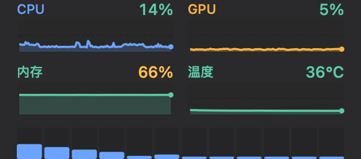
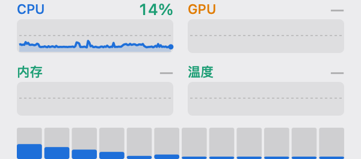

# MacMonBar

一个原生的 macOS 菜单栏前端，为 [macmon](https://github.com/vladkens/macmon) 而做——CPU、GPU、内存、温度一眼可见，并且**每一个核**的占用率都单独统计。

一个状态栏图标、四张趋势图、一个 540 行的 Swift 文件，**零第三方依赖**。

[English →](./README.md)

   

---

## 为什么做这个

`macmon` 是一个很好的、不需要 sudo 的 Apple Silicon 监控工具，但它住在终端里。在 Terminal.app 里跑它，等于同时养着一个窗口、一个标签页、一个登录 shell 和一份回滚缓冲区——内存上这是监控本身的四倍；CPU 上两者倒还打平（都不到 1% 个核）。

| 方案 | 物理内存占用 | 说明 |
|---|---|---|
| 在 Terminal.app 里跑 `macmon` | **约 75 MiB** | Terminal.app 72.2 MiB + `macmon` TUI 2.7 MiB |
| MacMonBar，菜单关闭 | **约 18.5 MiB** | App 12.9 MiB + `macmon pipe` 子进程 5.6 MiB |
| MacMonBar，菜单展开 | **约 24 MiB** | App 约 18 MiB（首次展开 +5）+ 子进程 5.6 MiB |

菜单栏也是三种"挂件"形态里唯一能做到 1 Hz 刷新的。桌面挂件和右侧通知中心挂件用的是**同一套** WidgetKit 技术：时间线驱动、被节流到分钟级、无法自己采样，还必须配一个宿主 App + App Group——最后往往比它包起来的东西还重。

## 截图

状态栏（默认状态：百分比按占用率着色、三个指标间有细竖线分隔、无进度条、不显示温度）：


打开进度条后的状态栏（百分比颜色区分默认已开启）：


打开温度显示后的状态栏：


展开后的面板——四张趋势图（2 行 × 2 列）+ 逐核柱状图：


同一面板的深色模式：



以及没装 `macmon` 时的样子——CPU 和逐核照常工作，其余优雅降级成"—"而不是误导性的 0%：




> 这些图不是屏幕截图，而是用 App 自己的 `draw(_:)` 代码对真实采样数据离线渲染出来的——见[复现截图](#复现截图)。

## 功能

- **状态栏**——CPU / GPU / 内存三个百分比分成三组，之间用细竖线分隔，且每个标签右对齐、紧贴自己的数字，一眼就能看出哪个数属于哪个指标。温度可选，默认关闭。
- **百分比按占用率着色。** 每个百分比按自身负载着色——低于 50% 绿、50% 起琥珀、80% 起红——扫一眼就知道谁在忙，不用去读数字。默认开启，菜单里可以关回纯文本。
- **进度条是可选项。** 那几条小进度条是独立的菜单开关，默认关闭。纯百分比是常驻屏幕角落最不打扰的形态；进度条留给你想一眼看出水位、而不是读具体数字的时候。
- **点击展开**——四张整格宽度面积图排成 2 行 × 2 列（CPU、GPU、内存、温度），当前值直接标在标题行；下方是逐核柱状图。
- **每一个核都统计到。** CPU 占用率由 App 自己通过 Mach `host_processor_info` 采样，所以所有核都会出现——M6 级别芯片上是 12 个。核数从内核读取，不写死。
- **没有 macmon 也能看 CPU。** 采样器跑在自己的 Timer 上，所以缺 macmon 只损失 GPU / 内存 / 温度三项，其余不受影响。这三项会显示"—"而不是 0%，菜单里也会多出一条直达安装说明的链接。
- **状态栏不显示瓦数。** 状态栏只放占用率；功耗对"写代码时该关注什么"这个决策没有帮助，所以刻意去掉了。
- **刷新间隔**——1 秒 / 2 秒 / 5 秒，菜单里直接切。
- **自动适配浅色 / 深色**，颜色阈值语义化（< 50% 绿、≥ 50% 琥珀、≥ 80% 红）。
- `LSUIElement`——没有 Dock 图标、没有窗口、不用切换。
- **无依赖。** 只用 AppKit + Foundation + Mach。没有 SwiftPM、没有 Carthage、没有任何第三方包。

## 环境要求

- macOS 13.0 及以上，Apple Silicon（不支持 Intel——在 Intel 上做一个菜单栏功耗监控没有意义）。
- Xcode Command Line Tools（需要 `swiftc`）。
- [macmon](https://github.com/vladkens/macmon) 装在 `~/.local/bin/macmon`——**GPU、内存、温度必需；CPU 可选。** MacMonBar 不含 macmon 的任何一行代码（用 Swift 重新实现），但运行时确实要调 `macmon` 这个二进制来拿这三项。CPU 占用率和逐核数据来自 App 自己的 Mach 采样器，有没有 macmon 都能用。

## 构建与运行

```bash
git clone https://github.com/HairuoLiu/MacMonBar.git
cd MacMonBar
./build.sh          # 编译 src/main.swift → ./MacMonBar.app
open MacMonBar.app
```

开机自启：**系统设置 → 通用 → 登录项与扩展 → 打开时登录 → +**，选 `MacMonBar.app`。（它是 `LSUIElement`，不会出现在 Dock 和切换器里。）

### 安装 macmon

```bash
brew install macmon
```

不想用包管理器的话，也可以从 [releases](https://github.com/vladkens/macmon/releases) 下载预编译的 arm64 二进制放进 `~/.local/bin`，并确认该目录在 `PATH` 里。MacMonBar 会把 `macmon pipe -i <interval>` 作为子进程拉起来，逐行读它的 JSON，不经过终端。

## 工作原理

```
  [装了 macmon]        macmon pipe -i 1000（子进程）
                       stdout JSON  ->  gpu_scaled_ratio
                                       ->  memory.ram_usage / ram_total
                                       ->  temp.cpu_temp_avg
                                           |
                                           +--> GPU / 内存 / 温度
                                           |    （没装 macmon 时这三项显示"—"）

  [任何时候]            Timer @ intervalMs          Mach host_processor_info
                       独立心跳，不等 macmon   -->  (PROCESSOR_CPU_LOAD_INFO)
                                                        |
                                                        v
                                          每核 user/system/nice/idle tick
                                                        |
                                                        v
                                          基于差值的占用率
                                          覆盖全部 N 个核 ──▶ MeterView（状态栏）
                                                            └▶ PanelView（展开面板）
```

**CPU 占用率是自己算的，不取 macmon 的值。** macmon 的 `cpu_usage_pct` 是一个*频率加权驻留*指标——核在各个 DVFS 档位上花了多少时间——而不是"这个核忙不忙"。12 线程全核压载时，两者能差出 1.7 倍：

| 负载 | Mach `host_processor_info` | macmon `cpu_usage_pct` |
|---|---|---|
| 空闲 | 21.4 % | — |
| 4 个忙线程 | 44.6 % | — |
| 6 个忙线程 | 59.9 % | — |
| **12 个忙线程（全核）** | **99.3 %** | **59.0 %** |

对于一个占用率仪表，你要的是第二列。`tools/cputest.swift` 可以复现这张表；`tools/coretest.swift` 打印逐核数值，并与 `mactop` 的 `core_usages` 交叉验证过（偏差 1 – 3 个百分点）。

### 一个不太容易发现的坑

`NSMenu` 展开时会在 `NSEventTrackingRunLoopMode` 里跑一个嵌套事件循环。用 `DispatchQueue.main.async` 投递的 block 在这个模式下**不会**被派发，所以最直觉的写法——管道回调 → `DispatchQueue.main.async` → 重绘——会让面板在你点下图标的那一刻就冻住。

直接测出来的结果：菜单展开的 25 秒里，后台队列收到 24 个采样，但只跑了 3 次 `ingest`、1 次重绘。

解决办法是把原始字节交给一个挂在 `RunLoop.main` 的 `.common` 模式上的 `Timer`，这个模式在事件跟踪期间照样会被驱动：

```swift
RunLoop.main.add(t, forMode: .common)
```

改完之后同样的 25 秒窗口变成 `bg=24 main=24 panelDraw=23`——面板在菜单展开期间是实打实每秒光栅化一次的。这也是下面功耗数字可信的原因：绘制的活是真的干了，没有被跳过。

## 和 macmon 到底是什么关系

这个问题人人都会问，所以单开一节：**没有使用 macmon 的任何代码。** 不是 fork、不是内嵌库、不是链接依赖。MacMonBar 是 543 行从零写的 Swift；macmon 是 Rust 写的。这个仓库里没有 Rust，也没有任何地方调用它的代码。

全部关系就是：MacMonBar 把 `macmon pipe -i <interval>` 拉成子进程，读它的 JSON。

| 指标 | 数字来自哪里 | 用了 macmon 的代码？ |
|---|---|---|
| CPU 占用率 | `CPUCoreSampler` → Mach `host_processor_info`（Apple API） | 否 |
| 逐核占用率 | 同一个采样器 | 否 |
| GPU 占用率 | macmon JSON 里的 `gpu_scaled_ratio` | 否——但是由 macmon 这个二进制算出来的 |
| 内存 % | macmon JSON 里的 `ram_usage` / `ram_total` | 否 |
| 温度 | macmon JSON 里的 `cpu_temp_avg` | 否 |

### 为什么保留这个依赖

四项指标里，两项换成原生很容易，两项很难。

| 指标 | 原生替代方案 | 工作量 |
|---|---|---|
| CPU / 逐核 | 已经是原生——跑在自己的 Timer 上 | 已完成 |
| 内存 | `host_statistics64` + `vm_statistics64` | 约 30 行，容易 |
| GPU 占用率 | IOReport 私有框架 | 难，且每次系统升级都可能失效 |
| 温度 | 没有公开 API——IOHID / SMC | 难，且每次系统升级都可能失效 |

难的两项恰好就是 macmon 已经解决的部分，也恰好是每次 macOS 更新都会崩的部分。自己重新实现，等于用一个 9 MiB 的子进程换一份长期的维护负担——而且会让 App 变得更不可靠，不是更可靠。

在 0.2.0 之前，这个耦合比看上去更紧：`cpuSampler.sample()` 只能从 `apply()` 到达，而 `apply()` 只在 macmon 管道送来完整 JSON 行时才跑。也就是说没装 macmon 时，不只是那三项，**连 CPU 都会一起停在 0%**。现在采样器有了自己的 `Timer`，依赖范围被诚实地限定在它真正提供的那三个指标上。

名字保留也是同一个道理：`MacMonBar` 说清楚了自己是什么——macmon 的菜单栏。一边还在调 macmon 的二进制、一边把名字里的 macmon 拿掉，那是更不诚实，不是更干净。

（许可证上没有义务：MIT 只要求在*软件副本*中保留声明，而这里一行都没带。但致谢照样给。）

## 实测资源占用

测试机：Apple M6，32 GB，macOS 13 时代 SDK。物理内存用 `libproc` 的 `proc_pid_rusage`（`ri_phys_footprint`）测，不用 RSS——footprint 才是 macOS 上跨进程比较内存的正确指标。

> **2026-10-13 全量复测。** 复测同时抓出并修掉了测量工具的一个单位 bug：`ri_user_time` / `ri_system_time` 的单位是 Mach tick（Apple Silicon 上 1 tick = 41.6667 ns），不是纳秒；此前三个测量脚本都按纳秒除了 `1e9`，**CPU 时间被低估 41.67 倍**。修正用单线程空转对照验证（应读回 ≈100% 个核）。以下数字全部出自修正后的 `tools/measure.py` 等脚本。

| | 终端方案 | MacMonBar，菜单关闭 | MacMonBar，菜单展开 |
|---|---|---|---|
| 常驻内存 | 约 75 MiB | 18.5 MiB | 约 24 MiB |
| CPU 时间 | 约 0.62% 个核 | 约 0.75% 个核 | 约 1.05% 个核 |

拆开看：终端方案 = Terminal.app（0.225% / 72.2 MiB）+ `macmon` TUI 模式（0.398% / 2.7 MiB）；关闭态 = App 本体（0.30% / 12.9 MiB）+ `macmon pipe` 子进程（0.465% / 5.6 MiB）；展开态 = 本体 0.585% + 子进程约 0.47%。

首次点开菜单约 **+5 MiB**（裸二进制实测 8.5 → 13.3 MiB）：菜单窗口和面板的备份存储只有在你点下图标之后才存在；重复点开不再增长（连续 9 次展开实测持平）。长时间驻留有缓慢堆增长——运行 1.5 小时的实例为 21.0 MiB，疑似每秒 JSON 解析留下的分配碎片。

### 功耗

整机功耗分辨不出这么小的一个应用。做了一次三方 A/B——什么都不跑 / 挂菜单栏 / 挂菜单栏再加一个终端窗口——三者分别测到 **10.41 W / 10.33 W / 10.38 W**，而单纯的重测噪声就有 **±0.71 W**。菜单栏的贡献在整机分辨率下根本区分不出来，所以下面这组数字改用实测 CPU 时间推算，标定系数来自同一台机器：

- 空闲：**8.60 W**
- 12 线程 100%：**19.13 W**
- ⇒ **12 核整体每 100% 对应 10.53 W**（约每 1 个百分点 0.105 W，折合每核满跑约 0.88 W）

每个状态实测 8 秒以上窗口、多轮复测（`tools/measure.py`）：

| 状态 | CPU 时间 | 增量功耗 | 每分钟能量 |
|---|---|---|---|
| 菜单栏常驻，**不点开** | 0.45 core-s/分 | 约 6.6 mW | 约 0.40 J |
| 菜单展开，4 张图 + 12 核条以 1 Hz 重绘 | 0.63 core-s/分 | 约 9.2 mW | 约 0.55 J |

功耗按标定系数线性外推，是**上限**：0.75% 的占空比不会真把核心频率拉起来，实际增量比这个低。

**有没有差距？相对意义上有，绝对意义上没有。** 展开菜单会多干约 **40%** 的活，折算下来约 2.6 mW、每分钟约 0.15 J——仍比整机测量的 ±0.71 W 噪声底低约 **270 倍**，约占整机空闲功耗的 **0.03%**。作为参照，正常浏览网页一分钟会把整机功耗推高几瓦（每分钟 100 – 200 J 量级）；这个 App 是 0.4 – 0.55 J。

常驻一整年，两个状态分别约 **58 Wh** 和 **80 Wh**——在 80 Wh 电池上约等于 0.7 次和 1.0 次满电，折成每天 0.16 / 0.22 Wh，约 **0.2% / 0.3% 电量每天**。Mac mini 是台式机，这串数字的实际意义是电费：一年几分钱。

App 自身的开销里，占大头的是它拉起来的 `macmon pipe` 子进程（0.465% = 0.28 core-s/分，占全家桶的 62%），其次是状态栏 `MeterView` 的每秒重绘（约 0.20%）——后者比四张趋势图加起来还贵。见下节。

### 开销分解（2026-10-13，实测）

把 App 拆成可拆除的积木逐块实测（菜单关闭、1 秒刷新基线上的增量）：

| 组件 | CPU | 说明 |
|---|---|---|
| `macmon pipe` 子进程 | 0.465% | 独立进程，提供 GPU / 内存 / 温度 |
| 状态栏 `MeterView` 重绘 + 状态项合成 | 约 0.20% | **单项最贵**，比 4 张趋势图加起来还贵 |
| JSON 摄入（管道 + 解析 + `apply` + 采样） | 约 0.04% | |
| 定时器 + AppKit 地板 | 约 0.04% | 空白 AppKit 常驻应用本身只要 0.004% |

刷新间隔（菜单里已有 1 / 2 / 5 秒三档，实测）：

| 刷新间隔 | App | 子进程 | 合计 | 相对现状 |
|---|---|---|---|---|
| 1 秒（默认） | 0.270% | 0.465% | 0.735% | — |
| 2 秒 | 0.172% | 0.235% | 0.407% | −45% |
| 5 秒 | 0.123% | 0.102% | 0.225% | −69% |

菜单展开态的增量（0.315%）再拆：趋势图数据路径 0.130%、逐核柱状图 0.022%、菜单事件跟踪与面板合成 0.163%。

GPU 方面：MacMonBar 自身实测 **0.000%**——纯 AppKit 2D 应用，光栅化在 CPU 侧，面板合成记在 WindowServer 账上。"减少 GPU 占用"对这个 App 是不存在的命题。

## 设计说明

**为什么选菜单栏而不是挂件。** 按资源消耗和复杂度排序，菜单栏赢在内存（约为终端方案的四分之一，18.5 vs 75 MiB）和形态纯粹性上：它是唯一能以 1 Hz 采样而不养一整个终端会话的形态，不需要宿主 App、不需要 App Group、不需要时间管线。CPU 上两者其实打平——但终端方案的窗口合成还有一笔记在 WindowServer 账上的隐形开销，没算进进程表。桌面挂件和通知中心挂件本质是同一套 WidgetKit，只是多了一层仪式。

**用图不用纯文字。** 光有百分比看不出趋势。四张 small multiples——一个指标一张、纵向排开——而不是两条叠在一起的 sparkline，因为折线交叉时叠线根本读不出来。每张图把当前值内嵌在标题行，配一条 50% 虚线参考线、18% 面积填充，以及最新采样点上的圆点。

**颜色要有语义。** CPU 蓝、GPU 橙、内存绿，外加一套在所有元素间保持一致的"红 / 琥珀 / 绿"阈值梯度。深色模式下色相会提亮，以维持对比度。

**固定宽度。** 面板固定 300 pt，左右各留 14 pt 内边距。宽度选择器被去掉了——一个监控工具应该有一个好用的默认值，而不是一个偏好设置面板。

## 复现截图

`docs/` 里的图不是屏幕截图，而是把真实采样数据喂给同一套 `PanelView` / `MeterView` 的 `draw(_:)`，再光栅化进 `NSBitmapImageRep`：

```swift
NSGraphicsContext.current = NSGraphicsContext(bitmapImageRep: rep)
view.frame = NSRect(x: 0, y: 0, width: w, height: h)
view.draw(view.bounds)
```

这样不需要屏幕录制权限，也不可能和 App 真实渲染出来的样子走偏。要重新生成，拿 `src/main.swift`，把底部的 `NSApplication.shared` 启动段换成一个采集器（读 `macmon pipe -i 200` 约 26 秒），然后以 `scale: 2`（面板）和 `scale: 3`（状态栏）在 `.aqua` 和 `.darkAqua` 下分别渲染。

两张 `-no-macmon-` 图走的是同一条管线，只是把 `macmonAvailable` 置为 `false` 并清空 GPU / 内存 / 温度的历史数组——那是真实的降级状态，不是手绘的示意图。

## `tools/`

几个小而专的脚本保留在这里，因为本 README 里每一个数字都出自其中之一。

| 文件 | 用途 |
|---|---|
| `cputest.swift` | 全核 CPU 精度测试：空闲 → 4 → 6 → 12 个忙线程 |
| `coretest.swift` | 打印逐核占用率；与 `mactop` 交叉验证 |
| `machsampler.swift` | 纯 Mach 采样器——零依赖基线 |
| `measure.py` | 用 `libproc` 测单进程 CPU% / RSS / 物理内存 |
| `measure_state.py` | 测某一状态在 N 秒内的 CPU 时间 |
| `power_ab.py` | 上表所用的两状态功耗 A/B |

任意一个都可以这样编译：`swiftc -O tools/<name>.swift -o /tmp/<name>`。

## 致谢

- [macmon](https://github.com/vladkens/macmon)（vladkens）——本项目前端所对接的无 sudo Apple Silicon 监控工具。MIT。
- 逐核精度与 [mactop](https://github.com/context-labs/mactop) 交叉验证。

## 更新记录

### 0.2.2 — 2026-10-13

- **状态栏重做。** 字号放大——标签 10 → 11 pt，数值 11 → 13 pt——并相应加宽标签与数值的预留宽度（这两个字体同时决定展开面板图表标题的字号，面板已重渲染确认无裁切）。那几条小进度条与百分比按占用率着色，现在是两个互相独立的菜单开关：进度条默认关闭；百分比着色**默认开启**——低于 50% 绿、50% 起琥珀、80% 起红。
- **指标间加分隔线。** 三个指标之间加了细竖线分隔，且每个标签右对齐、紧贴自己的百分比，解决了"哪个数属于哪个指标"的问题——此前数值离自己的标签很远，却离下一个指标的标签只有 6pt。
- **开销不变**：新默认不画进度条，每秒重绘本应略省，但放大的文字把省下的吃回去了。实测主进程 CPU 仍是约 0.26%（"开销分解"里约 0.20% 的状态栏重绘数字依然成立）。
- **文档**：按新默认重新生成截图，并新增 `statusbar-bars-light.png` 展示开启进度条（着色默认开）后的样子；面板因共用同一阈值函数也一并重渲染。

### 0.2.1 — 2026-10-13

- **修复（测量工具）**：`tools/` 下三个脚本把 `ri_user_time` / `ri_system_time` 当纳秒除了 `1e9`，实际单位是 Mach tick（41.6667 ns），CPU 时间被低估 41.67 倍。已按 `mach_timebase_info` 修正并用单线程空转对照验证。README 全部功耗 / CPU 数字随之重算。
- **文档**：新增"开销分解"一节——按组件实测（macmon 子进程 0.465%、状态栏重绘 0.20%、JSON 摄入 0.04%、AppKit 地板 0.04%）与刷新间隔三档的对照。

### 0.2.0 — 2026-10-13

- **修复**：没装 `macmon` 时，不只是那三项，**连 CPU 都会一起停在 0%**——因为 `cpuSampler.sample()` 只能通过 macmon 的 JSON 到达。现在 CPU 和逐核跑在独立的 `Timer` 上。
- **修复**：数据源缺失时，GPU / 内存 / 温度 显示"—"而不是误导性的 0%。
- **新增**：菜单里多一条直达 macmon 安装说明的入口，仅在 macmon 缺失时出现。
- **清理**：删除死代码——`kLabel`、`CPUCoreSampler.coreCount`、`AppDelegate.latest`（均为只写不用或完全未引用）。

### 0.1.0 — 2026-10-13

- 首个版本。

## 许可证

MIT——见 [LICENSE](./LICENSE)。
