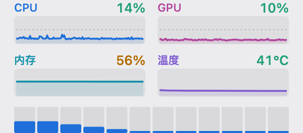

# CoreBar

**把 CPU、GPU、内存、温度放进 macOS 菜单栏——一个状态项、四张趋势图、芯片上每一个核心。**

手写应用——809 行 Swift 外加一个 515 行 C 传感器模块——**零第三方依赖、零子进程、全程没有 Python**。占用 **≈13 MiB 内存、0.26% 单核**，而把 [macmon](https://github.com/vladkens/macmon) 挂在终端窗口里要花 **≈75 MiB**。

[English →](./README.md) · [完整功能](docs/features.md) · [更新记录](CHANGELOG.md) · [**演讲稿 →**](TALK.zh-CN.md)

> 原名 **MacMonBar**。0.3.0 移除了最后一个与别的项目相关的东西之后，0.4.0 正式更名为 CoreBar。旧仓库链接仍会重定向到这里。

     




---

## 性能一览

| | 终端路线 | CoreBar | 差距 |
|---|---|---|---|
| 内存（footprint） | ≈ 75 MiB | **≈ 13 MiB** | **−83%** |
| CPU（2 秒刷新） | ≈ 0.62% 单核 | **0.26%** 单核 | −58% |
| 增量功耗 | — | **≈ 2.3 mW** | 每天约 0.07% 一格电 |
| GPU | — | **0.000%** | 纯 AppKit 2D，CPU 上光栅化 |

全部实测，不是估算——内存走 `libproc` 的 `ri_phys_footprint`，CPU 时间为多轮 15 秒以上窗口的统计。与最后一个双进程构建（v0.2.9，App + `macmon pipe` 子进程，同场并列实测）：**21.4 → 12.9 MiB（−40%）**、**0.392 → 0.263% 单核（−33%）**，且读数与 macmon 逐位一致。完整方法、开销分解、刷新间隔表、功耗标定与逐样本一致性对照表见 **[docs/performance.md](docs/performance.md)** · **[docs/macmon.md](docs/macmon.md)**。

## 为什么选它

- **CPU 数字是诚实的。** CPU 与逐核占用率由 App 自己用 Mach `host_processor_info` 采样，因此所有核心都在，核数也来自内核。macmon 自己的 `cpu_usage_pct` 是频率加权驻留度：12 线程全核加载时它报 **59.0%**，而真实利用率是 **99.3%**。**[原理 →](docs/how-it-works.md)**
- **一个进程，什么都不用装。** GPU 占用与温度由原生 C 模块（`src/sensors.c`）直连 `libIOReport` 与 `AppleSMC`/`IOHID` 读取——没有子进程、不用 `brew install`、不解析 JSON。**[子进程是怎么被去掉的 →](docs/macmon.md)**
- **没有 Dock 图标、没有窗口、没有可切换的界面。** `LSUIElement`，它只活在菜单栏里。
- **零依赖。** 只用 AppKit + Foundation + Mach + 一个 C 翻译单元。没有 SwiftPM、没有 Carthage、没有 vendor 代码，没有 Rust，也没有 Python——工具链和运行时都不含 Python。
- **不是小组件。** 菜单栏是唯一能 2Hz 采样又不必养着终端会话的形态，不需要宿主 App、不需要 App Group——WidgetKit 由时间线驱动并被节流到分钟级，所以小组件比它包裹的东西更重。
- **两套互不重叠的色系。** 图表用身份色（蓝 CPU / 玫红 GPU / 青内存 / 紫温度）；数字用数值色（按各自阈值绿 / 琥珀 / 红）。图表永远不会和一个穿同色的数字撞上。**[设计说明 →](docs/design.md)**

## 安装

需要 macOS 13+，原生支持 Apple Silicon 与 Intel（`x86_64`）。**除此之外什么都不用装**——没有配套的第三方二进制。

**直接下载**最新版本：

**[→ 下载 CoreBar（macOS Universal 通用版）](https://github.com/HairuoLiu/CoreBar/releases/latest)**
**[→ 下载 CoreBar Intel DMG 专用安装镜像（x86_64）](https://github.com/HairuoLiu/CoreBar/releases/download/v0.4.2/CoreBar-v0.4.2-intel-x86_64.dmg)**

解压，把 `CoreBar.app` 拖进 `/Applications`，打开。没有 Dock 图标——去看菜单栏。

**或者从源码构建**（需要 Xcode Command Line Tools）：

```bash
git clone https://github.com/HairuoLiu/CoreBar.git
cd CoreBar
./build.sh          # 编译 src/main.swift + src/sensors.c → ./CoreBar.app
open CoreBar.app
```

### 开机自启

**系统设置 → 通用 → 登录项与扩展 → 登录时打开 → +**，选中 `CoreBar.app`。

### 配置

点菜单栏图标即可：百分比着色（**开**）、进度条（关）、温度（关）、逐核柱（**开**）、刷新间隔（默认 **2 秒**，可选 1 / 2 / 5 秒）。完整菜单说明见 **[docs/features.md](docs/features.md)**。

<details>
<summary><b>给 AI Agent——无人值守安装</b></summary>

先确认环境：Apple Silicon（`arm64`）或 Intel（`x86_64`）机器，以及 macOS 13+（`sw_vers -productVersion`）。CoreBar 以 Universal Binary 形式构建，原生支持双平台。

```bash
#!/usr/bin/env bash
# CoreBar 无人值守安装，可重复执行。不需要 Python。
set -euo pipefail

# 1. CoreBar —— 从 API 解析最新资产，不要写死版本号
URL=$(curl -fsSL https://api.github.com/repos/HairuoLiu/CoreBar/releases/latest \
      | grep -o '"browser_download_url": *"[^"]*\.zip"' | head -n 1 \
      | sed 's/.*": *"//; s/"$//')
[ -n "$URL" ] || { echo "没找到 release 资源" >&2; exit 1; }
curl -fsSL "$URL" -o /tmp/CoreBar.zip
rm -rf /tmp/CoreBar-app && mkdir -p /tmp/CoreBar-app
unzip -oq /tmp/CoreBar.zip -d /tmp/CoreBar-app

# 2. 安装，并清掉 quarantine 位，避免 Gatekeeper 弹窗
rm -rf /Applications/CoreBar.app
mv /tmp/CoreBar-app/CoreBar.app /Applications/
xattr -dr com.apple.quarantine /Applications/CoreBar.app 2>/dev/null || true

# 3. 启动并确认进程存活——它是 LSUIElement，没有窗口可看
open /Applications/CoreBar.app
sleep 2
pgrep -x CoreBar >/dev/null && echo "OK: CoreBar running" || { echo "启动失败" >&2; exit 1; }
```

给 Agent 的几条提醒：

- 成功的标志是**一个**叫 `CoreBar` 的进程。没有子进程——GPU 与温度由原生 C 传感器模块在进程内读取。
- App 启动时不从磁盘读任何东西：没有 `PATH` 查找，没有需要验证的安装步骤。
- **不要**试图截图验证——它没有窗口。用 `pgrep` 和菜单栏上那一项是否存在来判断。
- 卸载：从菜单退出，删掉 `/Applications/CoreBar.app`。除此之外它不在 bundle 外写任何东西。

</details>

## 故障排查

<details>
<summary><b>出问题了——点开这里</b></summary>

| 现象 | 原因 | 解决 |
|---|---|---|
| GPU / 温度显示 `—` | 原生传感器模块初始化失败（罕见——通常是未来的 macOS 锁死了私有 API） | 无需安装任何东西。CPU 与内存照常工作；若持续出现请反馈 macOS 版本 |
| 全部指标都是 `—`，连 CPU 也是 | 理论上不该发生——CPU 有自己的定时器。请反馈 | — |
| 一直卡在 `0%` 不动 | 旧版本（≤ 0.1.x）所有指标都依赖 macmon | 升级到 0.2.0 或更高 |
| 重启后菜单栏那一项不见了 | 没有设置成登录项 | **系统设置 → 通用 → 登录项与扩展 → 登录时打开 → +** |
| 菜单栏那一项被藏进刘海底下 | 菜单栏排满时 macOS 会把右边的项挤掉 | 按住 `⌘` 拖动调整顺序，或退出其他菜单栏 App |
| 提示"CoreBar 已损坏／无法打开" | 下载的未签名构建带 Gatekeeper quarantine | `xattr -dr com.apple.quarantine /Applications/CoreBar.app` |
| 构建时报 `xcrun: error: invalid active developer path` | 没装 Command Line Tools | `xcode-select --install` |
| 构建时报 `swiftc: error: unable to find utility` | 同上 | 同上 |
| `open CoreBar.app` 之后什么都没发生 | 它是 `LSUIElement`，设计上就没有窗口和 Dock 图标 | 看菜单栏 |
| 菜单展开时面板冻住 | 0.2.0 已修（`DispatchQueue.main.async` 的重绘在 `NSEventTrackingRunLoopMode` 里不会执行） | 升级，[细节](docs/how-it-works.md) |
| Intel Mac 架构支持 | 构建产物为 Universal Binary (`arm64` + `x86_64`) | 官方原生支持：物理核心智能聚合、核显与独显双通道细分、SMC 硬件级测温 |
| CPU 数值和活动监视器不一致 | 预期之内。活动监视器显示的是频率加权驻留度，和 macmon 同一口径 | [细节](docs/how-it-works.md) |

</details>

## 截图

开启进度条——可选的水平刻度条：


传感器不可用时——CPU 与逐核照常工作，其余两项显示 `—` 而不是 `0%`：


深色模式、开启温度，以及降级状态下的面板：**[docs/screenshots.md](docs/screenshots.md)**。

## 深入了解

| 页面 | 内容 |
|---|---|
| [TALK.zh-CN.md](TALK.zh-CN.md) | **那个 75 兆的窗口**——18 分钟演讲稿，讲"测量"四次抓到我自信地犯错 |
| [docs/performance.md](docs/performance.md) | 内存 / CPU / 功耗实测、开销分解、刷新间隔表 |
| [docs/how-it-works.md](docs/how-it-works.md) | 数据流、Mach 采样器、C 传感器桥接、为何与 macmon 的 CPU 数值不同、`NSMenu` 事件循环坑 |
| [docs/macmon.md](docs/macmon.md) | GPU / 温度算法的来源、当初为什么用子进程，以及原生 C 模块是怎么取代它的 |
| [docs/features.md](docs/features.md) | 每个功能、每个菜单项、每个默认值 |
| [docs/design.md](docs/design.md) | 为什么是菜单栏、为什么用图、两套色系、宽度是量出来的 |
| [docs/tools.md](docs/tools.md) | 测量脚本，以及截图是怎么生成的 |
| [CHANGELOG.md](CHANGELOG.md) | 版本历史 |

## 致谢

- [macmon](https://github.com/vladkens/macmon)（作者 vladkens）——`src/sensors.c` 里 GPU 与温度算法的来源。CoreBar 用 C 重新实现了这套算法，直接读同一组私有接口；macmon 在这里的角色是逐位校验读数的参照，而不是依赖。MIT。
- 逐核准确度与 [mactop](https://github.com/context-labs/mactop) 交叉验证。

## 授权

MIT——见 [LICENSE](./LICENSE)。
