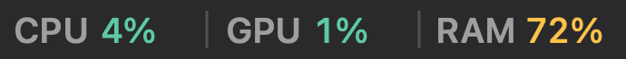
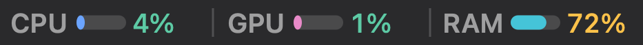
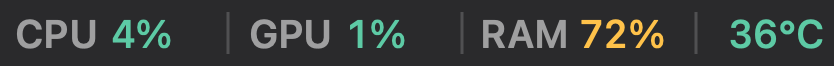

# Screenshots / 截图

[← Back to README](../README.md)

Every image here is rendered by the app's own `draw(_:)` code against real sampled data — not a screen capture. See [docs/tools.md](tools.md#reproducing-the-screenshots) for the pipeline. / 本页所有图片都由 App 自己的 `draw(_:)` 用真实采样数据渲染而成，不是屏幕截图；流程见 [docs/tools.md](tools.md)。

## Status bar / 状态栏

Default — colour-coded percentages, thin dividers, no gauges, temperature hidden. / 默认——百分比着色、细分隔线、无进度条、不显示温度。

Gauges switched on. / 打开进度条。

Temperature switched on. / 打开温度。

Dark mode. / 深色模式。

Dark mode, gauges on. / 深色模式，开启进度条。

Dark mode, temperature on. / 深色模式，开启温度。

## Expanded panel / 展开面板

Four trend charts (2 × 2) plus a per-core bar row. / 四张趋势图（2 × 2）加逐核柱状图。

## Without sensors / 传感器不可用

CPU, per-core and memory still work; GPU and temperature degrade to `—` instead of a misleading `0 %`. This is the state you would see if a future macOS locked down the private APIs. / CPU、逐核与内存仍然工作；GPU 与温度降级为 `—`，而不是误导性的 `0%`。这是未来的 macOS 锁死私有 API 时你会看到的状态。

